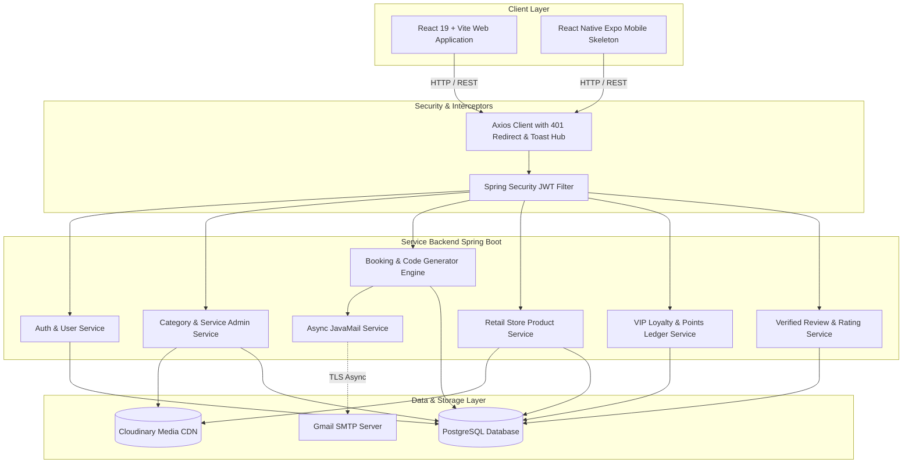

<div align="center">

# ✂️ Groomish Now
### Luxury Salon Management, Retail E-Commerce & VIP Loyalty Ecosystem

[](https://spring.io/projects/spring-boot)
[](https://openjdk.org/)
[](https://react.dev/)
[](https://vitejs.dev/)
[](https://tailwindcss.com/)
[](https://www.postgresql.org/)
[](https://cloudinary.com/)
[](LICENSE)

<p align="center">
  A state-of-the-art fullstack salon operating system uniting customer self-service booking, retail product e-commerce, stylist station queues, real-time GST tax invoicing, multi-tiered VIP loyalty points, and deep administrative control.
</p>

[Explore Features](#-feature-highlights) • [Architecture](#-system-architecture) • [Database Schema](#-database-schema--data-model) • [API Reference](#-api-endpoints-reference) • [Upcoming Roadmap](#-upcoming-roadmap-multi-store--notifications) • [Quickstart](#-quickstart--local-setup)

</div>

---

## 🎨 Official Brand Aesthetics

Groomish Now is designed with a bespoke luxury aesthetic featuring tailored color tokens, glassmorphic navigation, micro-interactions, and Google Fonts (`Outfit`, `Plus Jakarta Sans`, and `Playfair Display`):

| Palette Token | Hex Code | Preview | Usage |
| :--- | :--- | :---: | :--- |
| **Groomish Coral** | `#FC6957` | `■` | Primary buttons, active tabs, brand accents |
| **Charcoal Slate** | `#373A43` | `■` | Typography, dark containers, admin navigation |
| **Amber Gold** | `#FED652` | `■` | VIP tier badges, star ratings, reward points |
| **Cream Canvas** | `#FAF6ED` | `■` | App background, subtle card surfaces, pills |
| **Emerald Green** | `#34A955` | `■` | Completed states, success toasts, verified chips |
| **Crimson Rose** | `#EA4158` | `■` | Error badges, cancellations, urgent warnings |

---

## ✨ Feature Highlights

### 💇 1. Customer Experience & Public Catalog
- **Interactive Multi-Step Booking Flow**:
  - Interactive calendar date picker & dynamic slot groups with real-time slot availability.
  - Promo coupon code verification with instant cart deduction.
  - Itemized billing with tax calculation and payment method selection (UPI, Card, Pay at Salon).
  - Celebration confirmation dialog detailing booking code and points accrued.
- **Unique 10-Digit Human-Readable Booking ID (`GN-XX-XXXXXX`)**:
  - Format: `GN-[2 Alphanumeric]-[6 Digits]` (e.g., `GN-7K-481920`).
  - Generated via `SecureRandom` non-ambiguous uppercase characters for easy telephone recitation.
- **Dedicated Catalog Pages**:
  - Dedicated Categories Gallery (`/categories`) & Category Detail (`/category/:id`) with live gender filtering (**Women**, **Men**, **Unisex**, **All**).
  - Dedicated Treatment Detail Page (`/services/:id`) featuring high-resolution photography, what-to-expect badges, verified customer reviews, and sticky booking card.
- **Retail Beauty Shop & In-Store Pickup (`/products`)**:
  - Public catalog for in-store salon beauty products (Hair Care, Skin & Facial, Beard Grooming).
  - Live search, brand filters, in-store pickup indicators, and loyalty reward calculations.
- **Verified Customer Reviews & Ratings**:
  - Paginated customer reviews, star breakdown ratings, and public rating summaries.
  - Interactive 5-star review modal submitter for authenticated clients.

### ✂️ 2. Stylist Station (`/staff/dashboard`)
- **Queue Monitor**: Live queue of upcoming, in-progress, and completed appointments for the day.
- **Walk-in Client Registration**: Fast-track customer enrollment with automatic loyalty account creation.
- **In-Store Retail Product Attachment**: Stylists can attach store inventory items directly to client appointments with real-time stock deductions.
- **One-Click Bill & Complete**: Marking an appointment complete awards loyalty points, saves itemized snapshots, and triggers an official payment receipt email.

### 👑 3. Super Admin Command Center (`/admin/*`)
- **Real-Time Analytics**: Live metrics on daily revenue, appointments, active clients, and treatment distribution.
- **Catalog Management**: CRUD operations for Categories, Services, and Store Products with Cloudinary image uploaders.
- **Compact One-Pager Modals**: Redesigned dialogs (`AddServiceModal`, `EditServiceModal`) fitting comfortably on single screens without vertical scrollbars.
- **Universal Multi-Criteria Booking Search**: Universal search matching 10-digit booking codes, client names, phone numbers, and service titles.
- **Client & Stylist Directory**: Complete control over loyalty tiers, manual point adjustments, and staff assignments.
- **Reviews Moderation & Coupons**: Promotional discounts (flat amount or percentage) with expiry controls and review deletion moderation.

### 💎 4. VIP Loyalty & Gamification Engine
- **Tier Progression**: Automatic advancement through **Silver**, **Gold**, **Platinum**, and **Diamond** based on cumulative salon spending.
- **Points Ledger**: Transparent audit trail tracking points earned (+1 pt per ₹100 spent) and points redeemed for vouchers.
- **Viral Referral System**: Unique alphanumeric referral codes generated on signup with 1-click clipboard copy and WhatsApp sharing links.

### 📧 5. Asynchronous Gmail SMTP & Tax Invoicing
- **Non-Blocking Delivery**: Powered by Spring Boot `@Async` thread pools for instant UI responsiveness.
- **Branded Transactional Templates**:
  - `sendOtp`: Secure email OTP verification with Groomish branding.
  - `sendWelcome`: New user onboarding with initial referral codes.
  - `sendBookingConfirmation`: Appointment time, stylist, and service details.
  - `sendPaymentBillEmail`: Comprehensive tax invoice generated upon service completion with itemized breakdown of services, retail products, GST, discount, and Groomish points earned.

### 🚀 6. State-of-the-Art UX & System Hardening
- **Custom Smooth Rounded Selects (`CustomSelect.jsx`)**: Floating `rounded-2xl` custom dropdowns with animated chevrons, checkmark badges, and hover transitions replacing blocky native OS `<select>` elements.
- **Centralized 401 Session Interceptor**: Automatically purges expired credentials from `localStorage`, displays a branded authentication toast, and smoothly redirects unauthenticated visitors to `/login`.
- **Global Stacking Toast Hub**: Floating notifications container (`fixed top-5 right-5 z-[99999]`) supporting `useToast()` hooks and non-React `toastEmitter.*` calls.
- **Resilient Data Extraction (`extractList`)**: Universal normalizer preventing frontend crashes across Spring Boot `Page<T>` and raw JSON array payloads.

---

## 🏛️ System Architecture



---

## 🗄️ Database Schema & Data Model

```
                    ┌─────────────────┐
                    │      users      │
                    ├─────────────────┤
                    │ id (UUID, PK)   │
                    │ email (Unique)  │◄────────────┐
                    │ password (Hash) │             │
                    │ role (Enum)     │             │
                    │ points (Int)    │             │
                    │ tier (Enum)     │             │
                    │ referral_code   │             │
                    └────────┬────────┘             │
                             │                      │
       ┌─────────────────────┼──────────────────────┼─────────────────────┐
       │ 1:N                 │ 1:N                  │ 1:N                 │ 1:N
       ▼                     ▼                      ▼                     ▼
┌──────────────┐     ┌──────────────┐       ┌──────────────┐      ┌──────────────┐
│   bookings   │     │points_ledger │       │service_review│      │notifications │
├──────────────┤     ├──────────────┤       ├──────────────┤      ├──────────────┤
│id (UUID, PK) │     │id (UUID, PK) │       │id (UUID, PK) │      │id (UUID, PK) │
│booking_code  │     │user_id (FK)  │       │user_id (FK)  │      │user_id (FK)  │
│user_id (FK)  │     │change_amount │       │service_id(FK)│      │title, message│
│scheduled_at  │     │reason (Enum) │       │rating (1-5)  │      │type, seen    │
│total_amount  │     └──────────────┘       │review (Text) │      └──────────────┘
│status (Enum) │                            └──────────────┘
└──────┬───────┘
       │ 1:N
       ├─────────────────────────────────┐
       ▼                                 ▼
┌──────────────────────────┐    ┌──────────────────────────┐
│      booking_items       │    │     booking_products     │
├──────────────────────────┤    ├──────────────────────────┤
│ id (UUID, PK)            │    │ id (UUID, PK)            │
│ booking_id (FK)          │    │ booking_id (FK)          │
│ service_id (FK)          │    │ product_id (FK)          │
│ service_name_snapshot    │    │ product_name_snapshot    │
│ service_price_snapshot   │    │ product_price_snapshot   │
│ service_duration_snapshot│    │ quantity                 │
└──────────────────────────┘    └──────────────────────────┘
```

---

## ⚡ API Endpoints Reference

### 🔐 1. Authentication (`/api/v1/auth`)
| Method | Endpoint | Description | Access |
| :--- | :--- | :--- | :--- |
| `POST` | `/api/v1/auth/register` | Register new customer with referral code support | Public |
| `POST` | `/api/v1/auth/login` | Authenticate customer, staff, or admin & issue JWT | Public |
| `POST` | `/api/v1/auth/send-otp` | Request OTP verification code via Gmail | Public |
| `POST` | `/api/v1/auth/verify-otp` | Verify OTP code | Public |

### 🌐 2. Public Catalog & Store (`/api/v1/public`)
| Method | Endpoint | Description | Access |
| :--- | :--- | :--- | :--- |
| `GET` | `/api/v1/public/categories` | Browse all active salon categories | Public |
| `GET` | `/api/v1/public/services` | Query services with category and gender filters | Public |
| `GET` | `/api/v1/public/services/{id}` | Detailed service metadata and pricing | Public |
| `GET` | `/api/v1/public/products` | Browse active retail store products | Public |
| `GET` | `/api/v1/public/products/category/{cat}` | Filter store products by category | Public |
| `GET` | `/api/v1/public/reviews/service/{id}` | Verified customer reviews for a service | Public |
| `GET` | `/api/v1/public/reviews/service/{id}/summary` | Aggregate star ratings and review counts | Public |

### 👤 3. Customer Portal (`/api/v1/customer`)
| Method | Endpoint | Description | Access |
| :--- | :--- | :--- | :--- |
| `GET` | `/api/v1/customer/profile` | Retrieve customer profile and VIP loyalty balance | Customer |
| `PUT` | `/api/v1/customer/profile` | Update profile information | Customer |
| `POST` | `/api/v1/customer/change-password`| Update account password with email security alert | Customer |
| `GET` | `/api/v1/customer/bookings` | List my appointments (Upcoming, Completed, Cancelled) | Customer |
| `POST` | `/api/v1/customer/bookings` | Create new salon appointment | Customer |
| `POST` | `/api/v1/customer/payments/checkout` | Process payment, assign invoice, accrue loyalty points | Customer |
| `POST` | `/api/v1/customer/reviews` | Post verified service review and star rating | Customer |
| `GET` | `/api/v1/customer/rewards` | Browse redeemable loyalty vouchers | Customer |
| `POST` | `/api/v1/customer/rewards/{id}/redeem` | Spend points to claim voucher | Customer |

### ✂️ 4. Staff Stylist Station (`/api/v1/staff`)
| Method | Endpoint | Description | Access |
| :--- | :--- | :--- | :--- |
| `GET` | `/api/v1/staff/dashboard` | Stylist queue, completed count, and daily billing stats | Staff |
| `POST` | `/api/v1/staff/customers` | Register walk-in client with auto loyalty account | Staff |
| `GET` | `/api/v1/staff/products` | Store inventory available for appointment attachment | Staff |
| `POST` | `/api/v1/staff/booking/{id}/add-product` | Attach retail product to client's booking bill | Staff |
| `DELETE` | `/api/v1/staff/booking/{id}/product/{pId}` | Remove retail product from booking bill | Staff |
| `POST` | `/api/v1/staff/booking/{id}/complete-and-bill` | Complete service, deduct inventory & email tax receipt | Staff |

### 👑 5. Super Admin Command Center (`/api/v1/admin`)
| Method | Endpoint | Description | Access |
| :--- | :--- | :--- | :--- |
| `GET` | `/api/v1/admin/dashboard` | High-level analytics and revenue aggregations | Admin |
| `GET/POST` | `/api/v1/admin/categories` | List or create salon treatment categories | Admin |
| `GET/POST` | `/api/v1/admin/services` | List or create treatments with pricing & duration | Admin |
| `PUT/DELETE`| `/api/v1/admin/services/{id}` | Update or toggle service status | Admin |
| `GET/POST` | `/api/v1/admin/products` | Manage retail product inventory catalog | Admin |
| `GET` | `/api/v1/admin/bookings` | Search and filter all bookings with code lookup | Admin |
| `GET/POST` | `/api/v1/admin/coupons` | Manage promotional coupons and discount thresholds | Admin |
| `POST` | `/api/v1/admin/upload` | Upload images directly into Cloudinary folders | Admin |
| `DELETE` | `/api/v1/admin/reviews/{id}` | Moderate or remove abusive reviews | Admin |

---

## 🎯 Upcoming Roadmap: Multi-Store & Notifications

### 📍 Milestone 1: Multi-Store Architecture & Geolocation Engine
- [ ] **Backend `Store.java` Entity & Management**:
  - Model fields: `id`, `name`, `code` (e.g., `GN-BLR-INDIRANAGAR`), `address`, `city`, `phone`, `coverImage` (via Cloudinary `groomishnow/stores`), `latitude`, `longitude`, `active`, `openingHours`.
  - Admin Store CRUD APIs (`/api/v1/admin/stores`) to create, update, deactivate, and manage branches.
  - Public Store APIs (`/api/v1/public/stores`) with geospatial sorting.
- [ ] **Automated Geolocation & Nearest Store Suggestion**:
  - Utilize browser Geolocation API (`navigator.geolocation.getCurrentPosition()`) on initial visitor arrival.
  - Compute distances using the Haversine formula against active store coordinates to auto-select the nearest branch.
- [ ] **Navbar Store Selector**:
  - Interactive pill placed beside the Groomish logo in `Navbar.jsx` displaying **Store Name** and **Neighborhood / City**.
  - Dropdown popover with live search, distance metrics (e.g. `1.8 km away`), address preview, and 1-click store switching.
- [ ] **Store-Linked Staff & Branch Queues**:
  - Staff accounts linked to a specific `storeId`.
  - Staff login automatically scopes the session and redirects to their branch's station dashboard.
- [ ] **Store-Aware Appointments & Admin Filtering**:
  - Bookings capture `storeId` / store snapshot during customer checkout.
  - Stylists on `StaffDashboard` view queues and appointments strictly filtered to their branch.
  - Admin Bookings portal equipped with a multi-store dropdown filter.

### 🔔 Milestone 2: Comprehensive Notification Engine
- [ ] Multi-channel notification pipeline (in-app drawer, real-time popups via Toast Hub, and automated transactional emails).
- [ ] Automated lifecycle notifications: booking confirmation, stylist assignment, reminder alerts, completion invoices, tier upgrades, and promotional store announcements.

### 📱 Milestone 3: Cross-Platform Mobile Application (`/mobile_app`)
- [ ] Migrate skeleton to React Native Expo SDK 54 with NativeWind styling.
- [ ] Implement persistent authentication storage (AsyncStorage / SecureStore).
- [ ] Align mobile design with official Groomish Now brand colors and assets.

---

## 🚀 Quickstart & Local Setup

### 📋 Prerequisites
- **Java 21** & Maven 3.8+
- **Node.js 18+** & npm
- **PostgreSQL 14+** running locally or in Docker
- **Cloudinary Account** (Credentials pre-configured in properties)
- **Gmail App Password** (for transactional emails)

### 1. Database Setup
```sql
CREATE DATABASE loyalty_app_db;
```

### 2. Backend Configuration & Launch
Ensure `backend/src/main/resources/application.properties` contains your credentials:
```properties
spring.datasource.url=jdbc:postgresql://localhost:5432/loyalty_app_db
spring.datasource.username=postgres
spring.datasource.password=your_password

spring.mail.username=your_email@gmail.com
spring.mail.password=your_gmail_app_password

cloudinary.cloud-name=your_cloud_name
cloudinary.api-key=your_api_key
cloudinary.api-secret=your_api_secret
```

Run the Spring Boot application:
```bash
cd backend
./mvnw clean spring-boot:run
```
*Backend runs on `http://localhost:8008` (auto-seeds Super Admin `admin@loyaltyapp.com` / `Admin@123` and retail catalog).*

### 3. Frontend Web Setup & Launch
```bash
cd frontend_web
npm install
npm run dev
```
*Frontend runs on `http://localhost:5173`.*

---

<div align="center">
  <sub>Engineered with precision for <strong>Groomish Now</strong>. Built with Spring Boot 3.5, React 19 & Tailwind CSS.</sub>
</div>
