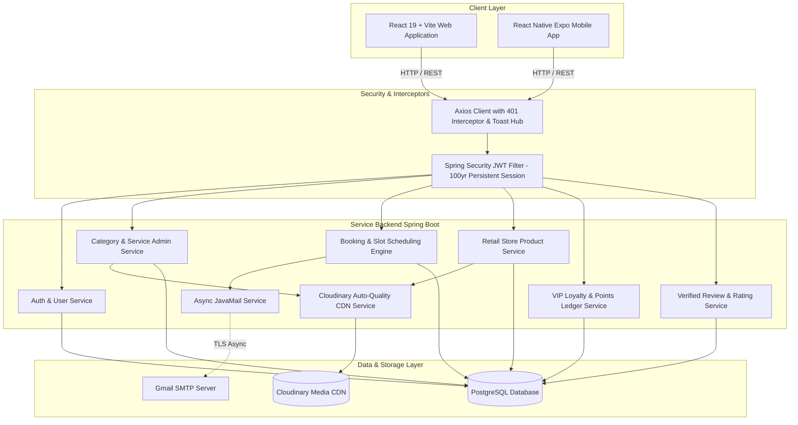

<div align="center">


### Luxury Salon Management, Retail E-Commerce and VIP Loyalty Ecosystem

[](https://spring.io/projects/spring-boot)
[](https://openjdk.org/)
[](https://react.dev/)
[](https://expo.dev/)
[](https://reactnative.dev/)
[](https://vitejs.dev/)
[](https://tailwindcss.com/)
[](https://www.postgresql.org/)
[](https://cloudinary.com/)
[](LICENSE)

<p align="center">
  A fullstack salon operating system uniting customer self-service booking, retail product e-commerce, stylist station queues, real-time GST tax invoicing, multi-tiered VIP loyalty points, customer cohort marketing, and administrative controls.
</p>

[Explore Pages & Flow](#application-pages--user-flow-directory) • [Feature Highlights](#feature-highlights) • [Image Guidelines](#recommended-image-dimensions-and-guidelines) • [Architecture](#system-architecture) • [Database Schema](#database-schema-and-data-model) • [API Reference](#api-endpoints-reference) • [Quickstart](#quickstart-and-local-setup)

</div>

---

## Official Brand Aesthetics

Groomish Now is designed with a bespoke luxury aesthetic featuring tailored color tokens, glassmorphic navigation, micro-interactions, and Google Fonts (`Outfit`, `Plus Jakarta Sans`, and `Playfair Display`):

| Palette Token | Hex Code | Usage |
| :--- | :---: | :--- |
| **Groomish Coral** | `#FC6957` | Primary buttons, active tabs, brand accents |
| **Charcoal Slate** | `#373A43` | Typography, dark containers, admin navigation |
| **Amber Gold** | `#FED652` | VIP tier badges, star ratings, reward points |
| **Cream Canvas** | `#FAF6ED` | App background, subtle card surfaces, pills |
| **Emerald Green** | `#34A955` | Completed states, success toasts, verified chips |
| **Crimson Rose** | `#EA4158` | Error badges, cancellations, urgent warnings |

---

## Recommended Image Dimensions and Guidelines

For optimal responsiveness, fast CDN delivery, and crisp rendering across Groomish Now web and mobile platforms:

| Entity | Recommended Dimension | Aspect Ratio | Resolution Range | Max File Size | Best File Formats | Purpose & Best Practices |
| :---: | :---: | :---: | :---: | :---: | :---: | :--- |
| **Category** | **600 × 600 px** | **1:1 (Square)** | 400×400 to 800×800 px | < 150 KB | WebP / PNG / JPG | Rendered in circular or rounded square category tiles. Use clean, centered service icons or isolated salon cuts with minimal background noise. |
| **Services** | **800 × 600 px** (or **1200 × 900 px**) | **4:3 (Landscape)** | 600×450 to 1200×900 px | < 250 KB | WebP / JPG | Standard 4:3 landscape format across web and mobile service catalogs and suggestion rows. Showcases haircuts, beard styling, facials, and spa rituals without vertical head cropping. |
| **Products** | **600 × 800 px** (or **900 × 1200 px**) | **3:4 (Portrait Retail)** | 600×800 to 900×1200 px | < 200 KB | WebP / PNG / JPG | Standard retail 3:4 aspect ratio on web and mobile. Centers the full product bottle or box with clean margins on a light background, enabling multi-image carousel browsing. |
| **Store / Salons** | **1200 × 675 px** (or **1200 × 800 px**) | **16:9** or **3:2** | 960×540 to 1600×900 px | < 350 KB | WebP / JPG | Wide landscape format is essential for storefronts, reception lounges, interior styling stations, and hair spa washing units. Supports multi-image salon photo galleries. |
| **Vouchers** | **800 × 600 px** | **4:3** | 600×450 to 1000×750 px | < 200 KB | WebP / PNG / JPG | Displayed in loyalty reward catalogs. Upload via integrated Cloudinary dialog or paste hosted image URLs. |

> [!TIP]
> **Automated Cloudinary Optimization:** All uploaded assets are processed through Cloudinary with automated quality and scaling:
> `cloudinary.url().transformation(new Transformation().quality("auto").chain().width(800).crop("scale"))`
> Delivering optimal web delivery sizes (40–90 KB) without sacrificing retina display crispness.

---

## Application Pages & User Flow Directory

This section provides a detailed walk-through of every page across Customer, Staff, and Admin portals. Use the dedicated screenshot placeholders to attach UI captures.

```
                              ┌──────────────────────────────────┐
                              │     Customer Discovery & Home    │
                              │           Route: /               │
                              └────────────────┬─────────────────┘
                                               │
                    ┌──────────────────────────┴──────────────────────────┐
                    ▼                                                     ▼
      ┌──────────────────────────┐                          ┌──────────────────────────┐
      │     Salon Treatments     │                          │    Retail Beauty Shop    │
      │   /categories, /services │                          │        /products         │
      └─────────────┬────────────┘                          └─────────────┬────────────┘
                    │                                                     │
                    └──────────────────────────┬──────────────────────────┘
                                               ▼
                              ┌──────────────────────────────────┐
                              │     Persistent Database Cart     │
                              │          Route: /cart            │
                              └────────────────┬─────────────────┘
                                               ▼
                              ┌──────────────────────────────────┐
                              │    Unified Checkout & Slots      │
                              │        Route: /checkout          │
                              └────────────────┬─────────────────┘
                                               ▼
                              ┌──────────────────────────────────┐
                              │   Authoritative Confirmation     │
                              │     /customer/bookings/:id       │
                              └────────────────┬─────────────────┘
                                               │
             ┌─────────────────────────────────┴─────────────────────────────────┐
             ▼                                                                   ▼
┌──────────────────────────┐                                       ┌──────────────────────────┐
│   Staff Stylist Station  │                                       │   Super Admin Portal     │
│     /staff/dashboard     │                                       │     /admin/dashboard     │
└──────────────────────────┘                                       └──────────────────────────┘
```

---

### Section I: Public Discovery & Customer Experience

#### 1. Landing Page (`/`)
- **Access**: Public / Guest
- **Flow**:
  1. Header includes the nearest salon branch selector (with GPS distance calculation via Haversine formula) and live database cart counter.
  2. Hero carousel showcases luxury seasonal campaigns and 1-click booking CTAs.
  3. Interactive Category Grid highlights trending treatments (Hair, Skin, Beard, Spa).
  4. Certified Brand Showcase features clean, rounded cards with authentic brand logos (L'Oréal, Kérastase, Minimalist, CeraVe, Maybelline, Moroccanoil, etc.).
  5. Verified customer reviews and Groom Coin VIP program breakdown.

> 📸 **Screenshot Placeholder**: _Landing Page Hero & Brand Showcase_
>
> ```markdown
> 
> ```

---

#### 2. Treatment Categories Directory (`/categories`)
- **Access**: Public
- **Flow**:
  1. Displays all active salon treatment categories.
  2. Quick filters for gender classification (**Women**, **Men**, **Unisex**, **All**).
  3. Clicking any category navigates to the dedicated category detail page with pre-filtered treatments.

> 📸 **Screenshot Placeholder**: _Categories Directory_
>
> ```markdown
> 
> ```

---

#### 3. Category Detail Page (`/category/:categoryId`)
- **Access**: Public
- **Flow**:
  1. Displays the category hero banner, icon, and description.
  2. Lists all services mapped under the selected category with top-right `{discountPercent}% OFF` badges.
  3. For multi-variant treatments, displays price & duration ranges with an **"Options"** button leading to the variant selector.
  4. For single-variant treatments, offers direct **"Add to Cart"** action with real-time cart badge update.

> 📸 **Screenshot Placeholder**: _Category Detail Page_
>
> ```markdown
> 
> ```

---

#### 4. Salon Services Catalog (`/services`)
- **Access**: Public
- **Flow**:
  1. Comprehensive directory of all salon treatments across hair, skin, beard, massage, and grooming.
  2. Real-time live search filter by service name or keyword.
  3. Filter chips by gender and category tags.
  4. Displays pricing, original strike-through MRP, duration, and Groom Coins earning potential.

> 📸 **Screenshot Placeholder**: _Services Catalog Page_
>
> ```markdown
> 
> ```

---

#### 5. Treatment Detail Page (`/services/:serviceId`)
- **Access**: Public
- **Flow**:
  1. High-resolution Cloudinary photo showcase of the treatment.
  2. Sub-service variants selector (e.g., Standard Haircut, Fade & Style, Senior Stylist) with dynamic duration and price updates.
  3. Sticky right-side pricing card showing original MRP, savings, duration, and Groom Coins credited upon completion.
  4. **Available Offers & Promotional Coupons Hub**: 1-click clipboard coupon code copy with live discount previews.
  5. Verified customer review breakdown with 5-star rating averages and customer comments.
  6. **"Add Service to Cart"** button (prompts modal sign-in if guest).

> 📸 **Screenshot Placeholder**: _Service Detail & Variant Selector_
>
> ```markdown
> 
> ```

---

#### 6. Retail Beauty Shop (`/products`)
- **Access**: Public
- **Flow**:
  1. E-commerce storefront for salon retail products (hair serums, facial cleansers, styling clays, masks).
  2. Compact Certified Brand Showcase row (8 brands per row) allowing 1-click brand filtering.
  3. Product cards display top-right `{discountPercent}% OFF` badges, volume/size info, pricing, strike-through MRP, and **"Add to Cart"**.
  4. In-store pickup badges and real-time inventory indicators.

> 📸 **Screenshot Placeholder**: _Retail Beauty Shop_
>
> ```markdown
> 
> ```

---

#### 7. Product Detail Page (`/products/:productId`)
- **Access**: Public
- **Flow**:
  1. High-definition product imagery with zoom capability.
  2. Normalized brand badge with official brand logo.
  3. Sticky right-side card showing quantity selector, stock availability, unit price, and MRP savings.
  4. Promotional Coupons strip for instant coupon code copying.
  5. Detailed product description, application instructions, and full ingredients list.

> 📸 **Screenshot Placeholder**: _Product Detail Page_
>
> ```markdown
> 
> ```

---

#### 8. Persistent Database Shopping Cart (`/cart`)
- **Access**: Customer (Database-Backed)
- **Flow**:
  1. Persistently backed by PostgreSQL database (`carts` and `cart_items`), preserving items across browsers, mobile app, and refreshes.
  2. Separates items into **Salon Services** and **Retail Products**.
  3. Salon Branch selector showing address, operating hours, and live GPS distance.
  4. Quantity adjustment controls (+ / -) and item removal triggers.
  5. Live Groom Coins calculation preview showing coins earned upon completion.
  6. **"Proceed to Appointment Checkout"** CTA.

> 📸 **Screenshot Placeholder**: _Database Shopping Cart_
>
> ```markdown
> 
> ```

---

#### 9. Unified Checkout & Slot Scheduling (`/checkout`)
- **Access**: Authenticated Customer
- **Flow**:
  1. **Appointment Scheduler**: Date picker and dynamic time slots with automated capacity protection (maximum 5 concurrent clients per slot across salon branch stylists).
  2. **Discount & Coupon Engine**: Input field for promotional coupon codes or VIP loyalty vouchers with combined multi-category minimum spend validation.
  3. **Payment Mode Selection**:
     - **Razorpay Online Payment** (UPI, Credit/Debit Card, NetBanking).
     - **Pay at Salon** (Cash / In-store terminal upon arrival).
  4. **Authoritative Post-Payment Confirmation**:
     - Successful online payment or salon booking triggers a dedicated confirmation screen displaying the 10-digit human-readable Reference (`GN-XX-XXXXXX`), amount paid, slot time, and a 4-second auto-redirect progress bar to Booking Details.
     - Failed or dismissed payments retain the booking in `PENDING` state with options to retry or switch payment modes.
  5. Dispatches an authoritative Gmail confirmation email and triggers real-time in-app notification.

> 📸 **Screenshot Placeholder**: _Checkout & Slot Scheduling_
>
> ```markdown
> 
> ```

---

#### 10. Customer Bookings Directory (`/customer/bookings`)
- **Access**: Authenticated Customer
- **Flow**:
  1. Filter tabs: **Upcoming**, **Completed**, and **Cancelled** appointments.
  2. Each card shows 10-digit reference code (`GN-KS-789032`), salon branch with Google Maps link, date, primary service name with `+X` additional items badge, total price, and status badge.
  3. Quick action buttons: **View Details**, **Reschedule**, and **Cancel Booking**.

> 📸 **Screenshot Placeholder**: _Customer My Bookings Directory_
>
> ```markdown
> 
> ```

---

#### 11. Customer Booking Detail Console (`/customer/bookings/:id`)
- **Access**: Authenticated Customer / Booking Owner
- **Flow**:
  1. Complete appointment status banner (`CONFIRMED`, `IN_PROGRESS`, `COMPLETED`, `CANCELLED`).
  2. Itemized services list showing service name, duration, price, strike-through MRP, and item status (shows **`CANCELLED`** in red when booking is cancelled).
  3. Retail products list with unit price and MRP savings.
  4. Interactive audit timeline showing order checkout, stylist assignment, status changes, and payment verification.
  5. Complete **Invoice Breakdown**: Subtotal, MRP discount, coupon discount, GST, and final paid amount.
  6. Action controls: 1-click Google Maps navigation to salon branch, Reschedule dialog, Cancel modal, and Review submitter upon completion.

> 📸 **Screenshot Placeholder**: _Customer Booking Details Console_
>
> ```markdown
> 
> ```

---

#### 12. VIP Loyalty Rewards & Vouchers (`/customer/rewards` & `/customer/vouchers`)
- **Access**: Authenticated Customer
- **Flow**:
  1. **Rewards Hub (`/customer/rewards`)**:
     - Displays spendable Groom Coins balance and cumulative `lifetimePoints`.
     - Lifetime VIP Tier progress bar (**Silver** -> **Gold** -> **Platinum** -> **Diamond**); clients never downgrade tiers when redeeming points.
     - Unique 6-character referral code with 1-click clipboard copy (+10 Coins earned per friend registration).
     - Redeemable Salon Vouchers catalog with point costs and instant redemption CTA.
  2. **My Vouchers Wallet (`/customer/vouchers`)**:
     - Active voucher codes with 1-click clipboard copy, expiry dates, and usage tracking.

> 📸 **Screenshot Placeholder**: _VIP Loyalty Rewards & Tier Progress_
>
> ```markdown
> 
> ```

---

#### 13. Customer Profile & Security (`/customer/profile`)
- **Access**: Authenticated Customer
- **Flow**:
  1. Personal details editor (Full Name, Phone Number, Gender, Date of Birth).
  2. Referral Code showcase with instant social sharing links.
  3. Secure Password Change modal with BCrypt encryption and automated email security alert.

> 📸 **Screenshot Placeholder**: _Customer Profile Page_
>
> ```markdown
> 
> ```

---

#### 14. FAQ & Salon Policies (`/qa`, `/policy`)
- **Access**: Public
- **Flow**:
  1. **FAQ & Help Center (`/qa`)**: Searchable accordion FAQs categorized under Booking, Groom Coins, Cancellation, and Hygiene.
  2. **Salon Policies (`/policy`)**: Comprehensive terms of service, appointment cancellation refund rules, privacy policy, and safety protocols.

> 📸 **Screenshot Placeholder**: _FAQ & Policies Page_
>
> ```markdown
> 
> ```

---

### Section II: Stylist Station & Branch Operations

#### 15. Staff Dashboard & Queue Monitor (`/staff/dashboard`)
- **Access**: Staff / Stylist / Branch Owner
- **Flow**:
  1. **Queue Monitor with Today's Priority**: Filter bookings by **Today's**, **Upcoming**, **Completed**, and **All** with dynamic badge counters. **Today's bookings are pinned to the top, sorted chronologically by time**.
  2. Displays booking cards with customer name, scheduled 12-hour AM/PM time, primary service with multiplier and `+X` items chip, price, and Groom Coins badge.
  3. Action buttons: **Client Check-in**, **Reschedule**, **Bill & Products** modal, and **Complete & Bill**.
  4. **Walk-in Customer Registration**: Instant on-spot enrollment form automatically creating a customer account with referral code.
  5. Persistent session login: stays logged in permanently until explicit logout.

> 📸 **Screenshot Placeholder**: _Staff Dashboard Queue Monitor_
>
> ```markdown
> 
> ```

---

#### 16. Staff Visual Analytics Dashboard (`/staff/dashboard?tab=analytics`)
- **Access**: Staff / Branch Owner
- **Flow**:
  1. Timeframe selector: **Day**, **Week**, **Month**, and **Custom Range** (with `CustomDatePicker`).
  2. Real-time KPI summary cards: Total Branch Revenue (INR), Appointments Handled, Completed Ratio, Average Ticket Value.
  3. Dual visualization mode: **Interactive SVG Bar Chart** and **Smooth Line Chart** with hover tooltips and gradient fills.
  4. Metric switch between Revenue and Total Appointments.

> 📸 **Screenshot Placeholder**: _Staff Branch Visual Analytics_
>
> ```markdown
> 
> ```

---

#### 17. Staff Booking Detail & In-Station Billing Console (`/staff/bookings/:id`)
- **Access**: Staff / Branch Stylist / Admin
- **Flow**:
  1. **Linear Station Progression**: `CONFIRMED` &rarr; `CLIENT_CHECKIN` &rarr; `COMPLETED & BILLED`.
     - When `CONFIRMED`: Only the **"Client Check-in"** action is presented.
     - Once checked in: The **"Complete & Bill"** action unlocks to finalize service and deliver digital tax invoice.
  2. **Selected Salon Services**: Itemized list with service image, duration, unit price, quantity multipliers, original strike-through MRP, and status (**`CANCELLED`** in red when cancelled). Clutter-free display without `#1`, `#2` indices.
  3. **Multi-Variant Sub-Service Selector**: When adding services with multiple sub-services/options, staff and admin can view all variants and select any option.
  4. **Retail Products In-Station Billing**: Add salon aftercare products (shampoo, serums, waxes) directly to the visit bill with MRP and selling price aligned neatly to the right (duplicate price tags near `Qty:` removed).
  5. **Clear Balance Breakdown & 12-Hour Timestamps**:
     - Standardized local 12-hour AM/PM timestamps (e.g. `26 Oct 2026, 04:40 PM`).
     - Transparent billing: **Total Bill**, **Already Paid Online (-₹pricePaid)**, and **Remaining Balance to Pay (₹remainingAmount)** with 1-click **"Switch to Pay at Salon Counter"**.
  6. Action buttons: **Complete & Bill Client** (triggers automatic GST tax receipt email via Gmail SMTP), **Cancel Booking**, and Google Maps branch navigation.

> 📸 **Screenshot Placeholder**: _Staff Booking Detail & Billing Console_
>
> ```markdown
> 
> ```

---

#### 18. Stylist Profile & Branch Information Hub (`/staff/dashboard?tab=profile`)
- **Access**: Staff
- **Flow**:
  1. Personal info editor for quick Name and Phone updates.
  2. Secure Change Password dialog with BCrypt verification and email alerts.
  3. Full Assigned Salon Branch card showing branch code, name, phone, email, full address, operating hours, and active status.

> 📸 **Screenshot Placeholder**: _Staff Profile & Branch Hub_
>
> ```markdown
> 
> ```

---

### Section III: Super Admin Command Center

#### 19. Executive Salon Dashboard (`/admin/dashboard`)
- **Access**: Super Admin
- **Flow**:
  1. Live aggregate KPI cards: Total Revenue (INR), Total Bookings, Active Customers, Salon Branches count.
  2. Recent appointment stream with instant status chips and 10-digit booking references.
  3. Revenue breakdown by payment methods (Online Razorpay, Cash, Card, UPI).

> 📸 **Screenshot Placeholder**: _Admin Executive Dashboard_
>
> ```markdown
> 
> ```

---

#### 20. Multi-Branch Stores Management (`/admin/stores`)
- **Access**: Super Admin
- **Flow**:
  1. Comprehensive salon branch directory.
  2. Add / Edit Salon modal with GPS coordinates (latitude, longitude), opening and closing time pickers (`CustomTimePicker`), full address, phone, and email.
  3. Multi-image Cloudinary photo gallery uploader (up to 6 photos showcasing reception, styling stations, and hair spa units).
  4. Branch-specific catalog override management: configure custom service prices and retail product stock levels per salon.

> 📸 **Screenshot Placeholder**: _Admin Multi-Branch Stores_
>
> ```markdown
> 
> ```

---

#### 21. Central Bookings Registry (`/admin/bookings`)
- **Access**: Super Admin
- **Flow**:
  1. Master registry of all bookings across all salon branches.
  2. Real-time search by 10-digit human-readable booking code (`GN-XX-XXXXXX`), customer name, or email.
  3. Filter dropdowns by salon branch, date range, appointment status (`CONFIRMED`, `COMPLETED`, `CANCELLED`), and payment status.
  4. Quick action buttons to view booking detail console or update status.

> 📸 **Screenshot Placeholder**: _Admin Bookings Registry_
>
> ```markdown
> 
> ```

---

#### 22. Admin Booking Override & Timeline Console (`/admin/bookings/:id`)
- **Access**: Super Admin
- **Flow**:
  1. Visual appointment reference card (`GN-KS-789032`) with customer and salon branch details.
  2. Selected Salon Services: shows service name, duration, strike-through MRP, price, and status (**`CANCELLED`** in bold red when booking is cancelled).
  3. Full itemized **Invoice Breakdown** with original MRP, catalog discounts, coupon savings, and taxes.
  4. **Booking Activity & Audit Timeline**: Full chronological audit trail of all actions taken on the booking with actor name and role.
  5. **Admin Controls & Overrides Panel**:
     - Administrative Status Dropdown override (`CONFIRMED`, `IN_PROGRESS`, `COMPLETED`, `CANCELLED`).
     - Reschedule Date and Time Slot picker override.
     - Payment Method and Payment Status override (`COMPLETED`, `PENDING`, `FAILED`).
     - Adjust Price Paid (INR) override.

> 📸 **Screenshot Placeholder**: _Admin Booking Override Console_
>
> ```markdown
> 
> ```

---

#### 23. Salon Treatment Categories Management (`/admin/categories`)
- **Access**: Super Admin
- **Flow**:
  1. Treatment category directory with name, slug, gender classification, and cover image.
  2. Add/Edit Category modal with Cloudinary drag-and-drop image upload.
  3. Instant Active/Inactive toggle switch without page reload.

> 📸 **Screenshot Placeholder**: _Admin Categories Management_
>
> ```markdown
> 
> ```

---

#### 24. Master Services Catalog (`/admin/services`)
- **Access**: Super Admin
- **Flow**:
  1. Comprehensive treatments directory with base price, MRP, duration, reward coins, and category mapping.
  2. Sub-services manager: configure multiple service variations with custom prices and durations.
  3. Cloudinary photo upload integration with auto-quality scaling (`w_800,q_auto`).
  4. Active / Inactive status toggle.

> 📸 **Screenshot Placeholder**: _Admin Services Management_
>
> ```markdown
> 
> ```

---

#### 25. Retail Products & Certified Brand Management (`/admin/products`)
- **Access**: Super Admin
- **Flow**:
  1. Master retail product inventory catalog with pricing, MRP, stock count, and volume/size.
  2. **Certified Brand Manager Modal**: CRUD operations for beauty brands (L'Oréal, Kérastase, Minimalist, CeraVe, etc.) with Cloudinary logo uploaders.
  3. Product Category Manager modal: create and manage retail product categories.
  4. In-Store Pickup flag toggle and active/inactive status switches.

> 📸 **Screenshot Placeholder**: _Admin Products & Brand Management_
>
> ```markdown
> 
> ```

---

#### 26. Customer Directory & Cohort Segmentation (`/admin/customers`)
- **Access**: Super Admin
- **Flow**:
  1. Full customer directory with search and pagination.
  2. Real-time cohort segmentation filters (`NEW_USER`, `SILVER`, `GOLD`, `PLATINUM`, `DIAMOND`, `HIGH_SPENDER`, `VIP_EXCLUSIVE`).
  3. Minimalist icon actions (View Profile, Activate/Deactivate, Force Delete).
  4. Customer Profile modal showing lifetime spend metrics, points ledger, booking history, and active cart inspector.

> 📸 **Screenshot Placeholder**: _Admin Customer Directory & Cohorts_
>
> ```markdown
> 
> ```

---

#### 27. Staff & Stylist Management (`/admin/staffs`)
- **Access**: Super Admin
- **Flow**:
  1. Salon staff directory showing assigned salon branch, role, phone, and status.
  2. Register Staff modal: assigns stylist to specific salon branch with locked `+91` 10-digit Indian phone validation.
  3. Edit Staff modal with administrative password override capability.
  4. 1-click active/inactive toggle and force delete controls.

> 📸 **Screenshot Placeholder**: _Admin Staff Management_
>
> ```markdown
> 
> ```

---

#### 28. Promotional Coupons & Group Broadcaster (`/admin/coupons`)
- **Access**: Super Admin
- **Flow**:
  1. Coupon registry with discount percentage or flat INR discount amount.
  2. Validity windows: Start Date and Expiry Date with quick preset buttons (+7d, +30d, +60d, +1y).
  3. Enforced 25-character maximum coupon code limit across frontend and backend.
  4. Targeting restrictions: restrict coupons to specific customer cohorts and salon treatment categories.
  5. **Group Email Broadcaster Modal**: Broadcast marketing campaign emails directly to selected customer groups via asynchronous Gmail SMTP.

> 📸 **Screenshot Placeholder**: _Admin Coupons & Email Broadcaster_
>
> ```markdown
> 
> ```

---

#### 29. VIP Rewards & Coin Economy Configuration (`/admin/rewards`)
- **Access**: Super Admin
- **Flow**:
  1. VIP loyalty reward vouchers catalog: create vouchers with coin costs, discount values, validity periods, and Cloudinary voucher images.
  2. Collapsible Groom Coin Economy configuration: adjust global spend-to-points ratios and minimum redemption thresholds.
  3. Clean voucher table layout with 1-click active toggle and delete actions.

> 📸 **Screenshot Placeholder**: _Admin Rewards & Economy Hub_
>
> ```markdown
> 
> ```

---

#### 30. Payments & Financial Ledger (`/admin/payments`)
- **Access**: Super Admin
- **Flow**:
  1. Master financial ledger tracking all customer transactions.
  2. Displays invoice number, payment method (Razorpay Online, Cash, Card, UPI), transaction status (`COMPLETED`, `PENDING`, `FAILED`, `CANCELLED`), amount, and timestamp.
  3. Search and filter by invoice number or payment method.

> 📸 **Screenshot Placeholder**: _Admin Financial Ledger_
>
> ```markdown
> 
> ```

---

#### 31. Customer Reviews Moderation (`/admin/reviews`)
- **Access**: Super Admin
- **Flow**:
  1. Customer service reviews moderation queue.
  2. Displays service name, reviewer name, star rating (1–5 stars), customer feedback comment, and creation date.
  3. 1-click delete/moderate action to remove inappropriate reviews.

> 📸 **Screenshot Placeholder**: _Admin Reviews Moderation_
>
> ```markdown
> 
> ```

---

#### 32. Salon Policies & FAQ Editor (`/admin/policies-qa`)
- **Access**: Super Admin
- **Flow**:
  1. Policy & FAQ management console.
  2. Create, reorder, and edit FAQ items and legal policy sections.
  3. Dynamically feeds public `/qa` and `/policy` routes across both web and mobile platforms.

> 📸 **Screenshot Placeholder**: _Admin Policies and FAQ Editor_
>
> ```markdown
> 
> ```

---

## Feature Highlights

### 1. Customer Experience and Public Catalog
- **Persistent Database Cart and Unified Checkout (`/cart`, `/checkout`)**:
  - Replaced direct booking with an e-commerce **"Add Service" / "Add Product" -> Cart -> Checkout** flow.
  - Cart is persistently backed by PostgreSQL database (`carts` and `cart_items`), preserving selections across refreshes, browsers, and devices.
  - Dedicated `/cart` page with treatment and product categorization, quantity adjustment, store assignment, and points preview.
  - Dedicated `/checkout` page with branch confirmation, appointment date and time slot selection (with 5-stylist capacity check), payment mode selection (Razorpay Online or Pay at Salon), and promo coupon or loyalty voucher redemption.
  - **Authoritative Post-Payment Confirmation Flow**:
    - Displays dedicated **"Booking & Payment Confirmed!"** screen only after successful payment verification (or when choosing Pay at Salon).
    - Renders official receipt summary (10-digit Booking Code, Amount Paid, Salon Branch, and Slot Time).
    - Features a 4-second animated progress bar with automatic redirection to `/customer/bookings/:id`, plus an instant **"View Booking Details Now"** button.
    - If payment is dismissed or fails, displays **"Booking Reserved (Payment Pending)"** with 1-click **"Try Online Payment Again"**, **"Switch to Pay at Salon"**, or view details in pending status.
  - **Spam-Free Notification Engine**:
    - Dispatches a single, authoritative confirmation notification (`"Order & Booking Confirmed"`) and email only after payment is finalized.
    - Guarded booking scheduler skips product-only orders and pending reservations from premature appointment alerts or cancellations.

### 2. Stylist Station and Branch Operations (`/staff/*`)
- **Queue Monitor and Branch Bookings**:
  - Filter tabs (**Today's**, **Upcoming**, **Completed**, **All**) with dynamic badge counters.
  - Quick access links to dedicated appointment consoles (`/staff/bookings/:id`).
- **Dedicated Staff Booking Detail Console (`/staff/bookings/:id`)**:
  - Interactive booking timeline tracking appointment progression (`PENDING` -> `CONFIRMED` -> `IN_PROGRESS` -> `COMPLETED`).
  - Searchable Groomish-themed dropdowns for attaching services and retail products to the bill.
  - Multiplier quantity displays: `Item Name X {quantity}` format for multiple units.
  - Itemized financial breakdown (Services, Products, Subtotal, GST, Discounts, Final Bill).
  - Status transitions (Start Service, Complete & Send Bill Email, Cancel).
  - Strike-through original MRP display on services and products matching the Admin section.
  - Service item status displays **`CANCELLED`** in bold red when appointment is cancelled.
- **Branch Visual Analytics Dashboard (`/staff/dashboard?tab=analytics`)**:
  - Timeframe selector: **Day**, **Week**, **Month**, and **Custom Range** (with `CustomDatePicker`).
  - Real-time KPI metric cards: Total Revenue (INR), Appointments Handled, Completed Ratio, Average Ticket Value.
  - Dual Visualization: **Bar Chart** (default) and **Line Chart** toggle with smooth SVG curve rendering, gradient fills, and interactive data point hover tooltips.

### 3. Multi-Store Geolocation and Branch Catalog Architecture
- **Nearest Store Proximity Engine**: Automatic GPS geolocation detection using Haversine formula calculation (Earth radius 6371 km) with distance tags (e.g. `1.2 km away`).
- **Interactive Navbar Store Selector**: Real-time store dropdown with live search, GPS re-detect, thumbnail previews, operating hours, and click-to-switch.
- **Localized Branch Catalog Overrides**:
  - `StoreServiceAvailability`: Enables branch-specific pricing, custom durations, and active toggles per salon.
  - `StoreProductInventory`: Branch-level retail product stock tracking, low-stock indicators, and in-store pickup flags.
- **Multi-Image Salon Gallery**: Cloudinary image galleries (up to 6 photos) showcasing storefronts, reception lounges, and hair spa stations.

### 4. Super Admin Command Center (`/admin/*`)
- **Fixed Viewport Navigation**: Anchored admin sidebar (`fixed top-0 left-0 bottom-0` with `pl-64` body offset) ensuring sidebar links remain visible regardless of vertical scroll depth.
- **Customer Directory and Cohort Segmentation (`/admin/customers`)**:
  - Real-time customer group filtering (`NEW_USER`, `SILVER`, `GOLD`, `PLATINUM`, `DIAMOND`, `HIGH_SPENDER`, `VIP_EXCLUSIVE`).
  - Customer Profile modal with detailed spend metrics, lifetime points, booking history, and active cart management.
- **Staff Directory (`/admin/staffs`)**:
  - Minimalist icon actions (Edit Staff, Activate/Deactivate, Force Delete).
  - Admin password override and locked `+91` 10-digit Indian phone number formatting.
- **Promotional Coupons Architecture (`/admin/coupons`)**:
  - Date validity windows with Start Date and Expiry Date (with +7d, +30d, +60d, +1y presets).
  - Target customer groups and salon category multi-select restrictions.
  - Enforced 25-character maximum coupon code limit across frontend input and backend services.
  - Group marketing email broadcaster modal for sending promotional announcements.

### 5. VIP Loyalty and Gamification Engine
- **Admin-Managed Tier Point Ranges**:
  - Super Admin can configure custom minimum and maximum point ranges for each loyalty tier (**Silver**, **Gold**, **Platinum**, **Diamond**) via `/admin/rewards`.
  - Existing tier labels remain intact for members who have already reached a tier level, while requiring the newly configured points threshold to advance to subsequent tiers.
- **Lifetime Tier Progression**:
  - Customer tiers are strictly calculated based on cumulative `lifetimePoints`.
  - Clients never downgrade tiers when redeeming spendable loyalty points for reward vouchers.
- **Points Ledger**: Transparent audit trail tracking points earned (+1 Groom Coin per ₹100 of eligible spend, rounding up when remainder is >= 50) and points redeemed for vouchers.
- **Referral System and Instant Rewards**: Unique 6-character alphanumeric referral codes generated on signup with 1-click clipboard copy and sharing links. Referrers receive **+10 VIP Reward Points** upon friend registration with dedicated ledger entries and real-time email notifications.

### 6. Cloudinary Media CDN & Auto-Optimization
- **Auto Quality & Scale Transformation**:
  All uploaded imagery across categories, services, products, and salon stores is automatically transformed with Cloudinary auto-quality compression and scaled to width 800:
  `cloudinary.url().transformation(new Transformation().quality("auto").chain().width(800).crop("scale"))`
- **Certified Brand Showcase**: Compact 8-brand logo row with normalized accent handling and timestamp-safe uploads.

### 7. Cross-Platform Luxury Mobile App (`mobile_app/`)
- **Expo SDK 57 & React Native**: Universal mobile client for iOS and Android with Expo Router file-based navigation and dark/light luxury theme engine.
- **Dynamic Brand Showcase**: Fetches certified brand profiles, names, and logos dynamically from `/api/v1/public/brands`.
- **4:3 Services & 3:4 Retail Product Presentation**:
  - Salon services rendered in **4:3 landscape** format across Home and catalog.
  - Retail products rendered in **3:4 aspect ratio** across Home, Shop, and Product details.
- **Slidable Multi-Image Product Details**: Horizontal paging carousel with dot indicators, counter badge, verified brand authenticity seal, and companion product recommendations.
- **Unified Booking Terminology & 12-Hour AM/PM Time**: Standardized "Booking" wording and 12-hour AM/PM format across all mobile views.
- **Payable Amount Breakdown**: Explicitly calculates `totalAmount`, `pricePaid`, and `remainingAmount`, with an Outstanding Balance Notice and 1-tap switch to pay at salon counter.
- **Dynamic Salon Policies & Q&A Screen**: Backed by `/api/v1/public/policy-faq` with live keyword search, dual-tab switcher, category filtering, and accordion FAQ cards.
- **Customer-Only Access Security Guard**: Dedicated portal restriction for Staff and Admin accounts with custom alert modal offering redirection to Customer Login or Home.

---

## System Architecture



---

## Database Schema and Data Model

```
                    ┌─────────────────┐
                    │      users      │
                    ├─────────────────┤
                    │ id (UUID, PK)   │
                    │ email (Unique)  │◄────────────┐
                    │ password (Hash) │             │
                    │ role (Enum)     │             │
                    │ points (Int)    │             │
                    │ lifetime_points │             │
                    │ tier (Enum)     │             │
                    │ referral_code   │             │
                    └────────┬────────┘             │
                             │                      │
       ┌─────────────────────┼──────────────────────┼─────────────────────┐
       │ 1:N                 │ 1:N                  │ 1:N                 │ 1:N
       ▼                     ▼                      ▼                     ▼
┌──────────────┐     ┌──────────────┐       ┌──────────────┐      ┌──────────────┐
│   bookings   │     │points_ledger │       │service_review│      │notifications │
├──────────────┤     ├──────────────┤       ├──────────────┤      ├──────────────┤
│id (UUID, PK) │     │id (UUID, PK) │       │id (UUID, PK) │      │id (UUID, PK) │
│booking_code  │     │user_id (FK)  │       │user_id (FK)  │      │user_id (FK)  │
│user_id (FK)  │     │change_amount │       │service_id(FK)│      │title, message│
│scheduled_at  │     │reason (Enum) │       │rating (1-5)  │      │type, seen    │
│total_amount  │     └──────────────┘       │review (Text) │      └──────────────┘
│status (Enum) │                            └──────────────┘
└──────┬───────┘
       │ 1:N
       ├─────────────────────────────────┐
       ▼                                 ▼
┌──────────────────────────┐    ┌──────────────────────────┐
│      booking_items       │    │     booking_products     │
├──────────────────────────┤    ├──────────────────────────┤
│ id (UUID, PK)            │    │ id (UUID, PK)            │
│ booking_id (FK)          │    │ booking_id (FK)          │
│ service_id (FK)          │    │ product_id (FK)          │
│ service_name_snapshot    │    │ product_name_snapshot    │
│ service_price_snapshot   │    │ product_price_snapshot   │
│ service_duration_snapshot│    │ quantity                 │
│ status (Enum)            │    │ total_price              │
└──────────────────────────┘    └──────────────────────────┘
```

---

## API Endpoints Reference

### 1. Authentication (`/api/v1/auth`)
| Method | Endpoint | Description | Access |
| :--- | :--- | :--- | :--- |
| `POST` | `/api/v1/auth/register` | Register new customer with referral code support | Public |
| `POST` | `/api/v1/auth/login` | Authenticate customer, staff, or admin and issue JWT | Public |
| `GET`  | `/api/v1/auth/verify-referral` | Check referral code validity before signup | Public |
| `POST` | `/api/v1/auth/send-otp` | Request OTP verification code via Gmail | Public |
| `POST` | `/api/v1/auth/verify-otp` | Verify OTP code | Public |

### 2. Public Catalog, Stores and Reviews (`/api/v1/public`)
| Method | Endpoint | Description | Access |
| :--- | :--- | :--- | :--- |
| `GET` | `/api/v1/public/categories` | Browse all active salon categories | Public |
| `GET` | `/api/v1/public/services` | Query services with category and gender filters | Public |
| `GET` | `/api/v1/public/services/{id}` | Detailed service metadata and pricing | Public |
| `GET` | `/api/v1/public/products` | Browse active retail store products | Public |
| `GET` | `/api/v1/public/products/category/{cat}` | Filter store products by category | Public |
| `GET` | `/api/v1/public/brands` | List certified salon brands and logos | Public |
| `GET` | `/api/v1/public/stores` | List branches sorted by distance (`?lat=..&lng=..`) | Public |
| `GET` | `/api/v1/public/stores/{id}/services` | Localized services available at branch | Public |
| `GET` | `/api/v1/public/stores/{id}/products` | Localized retail products in stock at branch | Public |
| `GET` | `/api/v1/public/coupons` | Browse active public promotional coupons | Public |
| `GET` | `/api/v1/public/reviews/service/{id}` | Verified customer reviews for a service | Public |
| `GET` | `/api/v1/public/reviews/service/{id}/summary` | Aggregate star ratings and review counts | Public |

### 3. Customer Portal (`/api/v1/customer`)
| Method | Endpoint | Description | Access |
| :--- | :--- | :--- | :--- |
| `GET` | `/api/v1/customer/profile` | Retrieve customer profile and VIP loyalty balance | Customer |
| `PUT` | `/api/v1/customer/profile` | Update profile information | Customer |
| `POST` | `/api/v1/customer/change-password`| Update account password with email security alert | Customer |
| `GET` | `/api/v1/customer/cart` | Retrieve database-persistent active cart | Customer |
| `POST` | `/api/v1/customer/cart/items` | Add service or product item to cart | Customer |
| `PUT` | `/api/v1/customer/cart/items/{itemId}` | Update item quantity or notes | Customer |
| `DELETE`| `/api/v1/customer/cart/items/{itemId}` | Remove item from cart | Customer |
| `POST` | `/api/v1/customer/cart/checkout` | Unified cart checkout to booking and products | Customer |
| `GET` | `/api/v1/customer/bookings` | List my appointments (Upcoming, Completed, Cancelled) | Customer |
| `POST` | `/api/v1/customer/reviews` | Post verified service review and star rating | Customer |
| `GET` | `/api/v1/customer/rewards` | Browse redeemable loyalty vouchers | Customer |
| `POST` | `/api/v1/customer/rewards/{id}/redeem` | Spend points to claim voucher | Customer |

### 4. Staff Stylist Station and Branch Operations (`/api/v1/staff`)
| Method | Endpoint | Description | Access |
| :--- | :--- | :--- | :--- |
| `GET` | `/api/v1/staff/dashboard` | Stylist queue, completed count, and daily billing stats | Staff |
| `GET` | `/api/v1/staff/dashboard/analytics` | Branch revenue and appointment trends (`?period=...`) | Staff |
| `GET` | `/api/v1/staff/profile` | Stylist profile and assigned salon branch specifications | Staff |
| `PUT` | `/api/v1/staff/profile` | Update stylist personal details (Name, Phone) | Staff |
| `PUT` | `/api/v1/staff/profile/change-password` | Change account password with BCrypt verification | Staff |
| `POST` | `/api/v1/staff/customers` | Register walk-in client with auto loyalty account | Staff |
| `GET` | `/api/v1/staff/carts/customer/{id}` | Inspect active customer cart | Staff |
| `GET` | `/api/v1/staff/products` | Store inventory available for appointment attachment | Staff |
| `POST` | `/api/v1/staff/booking/{id}/add-product` | Attach retail product to client's booking bill | Staff |
| `DELETE`| `/api/v1/staff/booking/{id}/product/{pId}` | Remove retail product from booking bill | Staff |
| `POST` | `/api/v1/staff/booking/{id}/complete-and-bill` | Complete service, deduct inventory and email tax receipt | Staff |
| `GET` | `/api/v1/staff/stores/catalog/services` | View localized services configured for branch | Staff |
| `GET` | `/api/v1/staff/stores/catalog/products` | View localized inventory for branch | Staff |

### 5. Super Admin Command Center (`/api/v1/admin`)
| Method | Endpoint | Description | Access |
| :--- | :--- | :--- | :--- |
| `GET` | `/api/v1/admin/dashboard` | High-level analytics and revenue aggregations | Admin |
| `GET/POST` | `/api/v1/admin/users` | List customers with group and search filters | Admin |
| `PUT` | `/api/v1/admin/users/{id}/deactivate` | Toggle customer active status | Admin |
| `DELETE` | `/api/v1/admin/users/{id}/force` | Permanently remove customer record | Admin |
| `GET/POST` | `/api/v1/admin/staffs` | List or register salon staff members | Admin |
| `PUT` | `/api/v1/admin/staffs/{id}` | Update staff profile, branch, or password | Admin |
| `GET/POST` | `/api/v1/admin/stores` | List branches or create new salon branch | Admin |
| `PUT/DELETE`| `/api/v1/admin/stores/{id}` | Update branch details or toggle active status | Admin |
| `GET/PUT` | `/api/v1/admin/stores/{id}/catalog/services` | Manage branch-specific service price overrides | Admin |
| `GET/PUT` | `/api/v1/admin/stores/{id}/catalog/products` | Manage branch-specific product stock counts | Admin |
| `GET/POST` | `/api/v1/admin/categories` | List or create salon treatment categories | Admin |
| `GET/POST` | `/api/v1/admin/services` | List or create treatments with pricing and duration | Admin |
| `PUT/DELETE`| `/api/v1/admin/services/{id}` | Update or toggle service status | Admin |
| `GET/POST` | `/api/v1/admin/products` | Manage retail product inventory catalog | Admin |
| `GET/POST` | `/api/v1/admin/brands` | Manage certified beauty brands and logo assets | Admin |
| `GET` | `/api/v1/admin/bookings` | Search and filter all bookings with code lookup | Admin |
| `PUT` | `/api/v1/admin/bookings/{id}/status` | Update booking status (`CONFIRMED`, `COMPLETED`, etc.) | Admin |
| `GET/POST` | `/api/v1/admin/coupons` | List or create promotional coupons | Admin |
| `PUT` | `/api/v1/admin/coupons/{id}` | Update coupon details, validity, groups, or status | Admin |
| `DELETE` | `/api/v1/admin/coupons/{id}` | Force delete promotional coupon | Admin |
| `POST` | `/api/v1/admin/coupons/broadcast-email` | Broadcast campaign email to user group | Admin |
| `POST` | `/api/v1/admin/upload` | Upload images directly into Cloudinary folders | Admin |
| `DELETE` | `/api/v1/admin/reviews/{id}` | Moderate or remove abusive reviews | Admin |

---

## Quickstart and Local Setup

### Prerequisites
- **Java 21** and Maven 3.8+
- **Node.js 18+** and npm
- **PostgreSQL 14+** running locally or in Docker
- **Cloudinary Account** (credentials configured in application properties)
- **Gmail App Password** (for transactional emails)
- **Expo Go App** (optional, on iOS or Android device for mobile testing)

### 1. Database Setup
```sql
CREATE DATABASE loyalty_app_db;
```

### 2. Backend Configuration and Launch
Ensure `backend/src/main/resources/application.properties` contains your credentials:
```properties
spring.datasource.url=jdbc:postgresql://localhost:5432/loyalty_app_db
spring.datasource.username=postgres
spring.datasource.password=your_password

# 100-Year Permanent Session Expiry
app.jwt.expiration-ms=3153600000000

spring.mail.username=your_email@gmail.com
spring.mail.password=your_gmail_app_password

cloudinary.cloud-name=your_cloud_name
cloudinary.api-key=your_api_key
cloudinary.api-secret=your_api_secret
```

Run the Spring Boot application:
```bash
cd backend
./mvnw clean spring-boot:run
```
*Backend runs on `http://localhost:8008` (auto-seeds Super Admin `admin@groomish.now` and retail catalog).*

### 3. Frontend Web Setup and Launch
```bash
cd frontend_web
npm install
npm run dev
```
*Frontend runs on `http://localhost:5173`.*

### 4. Cross-Platform Mobile App Setup and Launch
```bash
cd mobile_app
npm install
npx expo start --tunnel
```
*Scan the generated QR code using the **Expo Go** app on Android or iOS.*

---

<div align="center">
  <sub>Engineered with precision for <strong>Groomish Now</strong>. Built with Spring Boot 3.5, React 19, Tailwind CSS, and Expo SDK 57.</sub>
</div>
