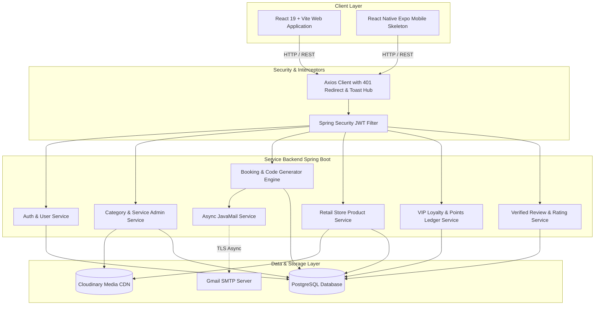

<div align="center">


# Groomish Now
### Luxury Salon Management, Retail E-Commerce and VIP Loyalty Ecosystem

[](https://spring.io/projects/spring-boot)
[](https://openjdk.org/)
[](https://react.dev/)
[](https://vitejs.dev/)
[](https://tailwindcss.com/)
[](https://www.postgresql.org/)
[](https://cloudinary.com/)
[](LICENSE)

<p align="center">
  A fullstack salon operating system uniting customer self-service booking, retail product e-commerce, stylist station queues, real-time GST tax invoicing, multi-tiered VIP loyalty points, customer cohort marketing, and administrative controls.
</p>

[Explore Features](#feature-highlights) • [Image Guidelines](#recommended-image-dimensions-and-guidelines) • [Architecture](#system-architecture) • [Database Schema](#database-schema-and-data-model) • [API Reference](#api-endpoints-reference) • [Quickstart](#quickstart-and-local-setup)

</div>

---

## Official Brand Aesthetics

Groomish Now is designed with a bespoke luxury aesthetic featuring tailored color tokens, glassmorphic navigation, micro-interactions, and Google Fonts (`Outfit`, `Plus Jakarta Sans`, and `Playfair Display`):

| Palette Token | Hex Code | Preview | Usage |
| :--- | :--- | :---: | :--- |
| **Groomish Coral** | `#FC6957` | `■` | Primary buttons, active tabs, brand accents |
| **Charcoal Slate** | `#373A43` | `■` | Typography, dark containers, admin navigation |
| **Amber Gold** | `#FED652` | `■` | VIP tier badges, star ratings, reward points |
| **Cream Canvas** | `#FAF6ED` | `■` | App background, subtle card surfaces, pills |
| **Emerald Green** | `#34A955` | `■` | Completed states, success toasts, verified chips |
| **Crimson Rose** | `#EA4158` | `■` | Error badges, cancellations, urgent warnings |

---

## Recommended Image Dimensions and Guidelines

For optimal responsiveness, fast CDN delivery, and crisp rendering across Groomish Now web and mobile platforms:

| Entity | Recommended Dimension | Aspect Ratio | Resolution Range | Max File Size | Best File Formats | Purpose & Best Practices |
| :---: | :---: | :---: | :---: | :---: | :---: |
| **Category** | **600 × 600 px** | **1:1 (Square)** | 400×400 to 800×800 px | < 150 KB | WebP / PNG / JPG | Rendered in circular or rounded square category tiles. Use clean, centered service icons or isolated salon cuts with minimal background noise. |
| **Services** | **800 × 600 px** (or **1200 × 800 px**) | **4:3** or **3:2** | 600×450 to 1200×900 px | < 250 KB | WebP / JPG | Used in service cards and booking modals. 4:3 provides optimal vertical space to showcase haircuts, beard trims, facials, and styling without cropping heads. |
| **Products** | **1000 × 1000 px** | **1:1 (Square)** | 800×800 to 1200×1200 px | < 200 KB | WebP / PNG / JPG | Standard e-commerce square ratio. Shows the product bottle/pack centered on a clean white or light-neutral background (`#F9F9FB`), allowing seamless zoom and multi-angle viewing. |
| **Store / Salons** | **1200 × 675 px** (or **1200 × 800 px**) | **16:9** or **3:2** | 960×540 to 1600×900 px | < 350 KB | WebP / JPG | Wide landscape format is essential for storefronts, reception lounges, interior styling stations, and hair spa washing units. Supports multi-image salon photo galleries. |
| **Vouchers** | **800 × 600 px** | **4:3** | 600×450 to 1000×750 px | < 200 KB | WebP / PNG / JPG | Displayed in loyalty reward catalogs. Upload via integrated Cloudinary dialog or paste hosted image URLs. |

> [!TIP]
> **Cloudinary Optimization Rule:** Always deliver images through Cloudinary with automated format and compression (`f_auto,q_auto`) to achieve ultra-fast load times (40–90 KB) without sacrificing retina display crispness.

---

## Feature Highlights

### 1. Customer Experience and Public Catalog
- **Persistent Database Cart and Unified Checkout (`/cart`, `/checkout`)**:
  - Replaced direct booking with an e-commerce **"Add Service" / "Add Product" -> Cart -> Checkout** flow.
  - Cart is persistently backed by PostgreSQL database (`carts` and `cart_items`), preserving selections across refreshes, browsers, and devices.
  - Live reactive `ShoppingCart` badge in the header navbar and mobile drawer.
  - Dedicated `/cart` page with treatment and product categorization, quantity adjustment, store assignment, and points preview.
  - Dedicated `/checkout` page with branch confirmation, appointment date and time slot selection (with 5-stylist capacity check), payment mode selection, and promo coupon or loyalty voucher redemption.
  - Unauthenticated clients clicking "Add Service" are prompted with the Login/Register modal before services are placed in the cart.
- **Available Offers and Promotional Coupons Hub**:
  - Luxury "Available Offers & Promotional Coupons" strip on Treatment Detail (`/services/:id`) and Products page (`/products`).
  - 1-click clipboard coupon copy with real-time discount preview.
- **Unique 10-Digit Human-Readable Booking ID (`GN-XX-XXXXXX`)**:
  - Format: `GN-[2 Alphanumeric]-[6 Digits]` (e.g., `GN-7K-481920`).
  - Generated via `SecureRandom` non-ambiguous uppercase characters for easy telephone recitation.
- **Dedicated Catalog Pages**:
  - Dedicated Categories Gallery (`/categories`) and Category Detail (`/category/:id`) with live gender filtering (**Women**, **Men**, **Unisex**, **All**).
  - Dedicated Treatment Detail Page (`/services/:id`) featuring high-resolution photography, what-to-expect badges, verified customer reviews, offers section, and "Add Service to Cart" CTA.
- **Retail Beauty Shop and In-Store Pickup (`/products`)**:
  - Public catalog for salon beauty products with promotional offers banner, live search, and "Add Product to Cart" actions.
- **Verified Customer Reviews and Ratings**:
  - Paginated customer reviews, star breakdown ratings, and public rating summaries.
  - Interactive 5-star review modal submitter for authenticated clients.

### 2. Stylist Station and Branch Operations (`/staff/*`)
- **Queue Monitor and Branch Bookings**:
  - Filter tabs (**Today's**, **Upcoming**, **Completed**, **All**) with dynamic badge counters.
  - Quick access links to dedicated appointment consoles (`/staff/bookings/:id`).
  - Cleaned layout with removal of redundant top header banners, keeping focus on operations.
- **Dedicated Staff Booking Detail Console (`/staff/bookings/:id`)**:
  - Interactive booking timeline tracking appointment progression (`PENDING` -> `CONFIRMED` -> `IN_PROGRESS` -> `COMPLETED`).
  - Searchable Groomish-themed dropdowns for attaching services and retail products to the bill.
  - Multiplier quantity displays: `Item Name X {quantity}` format for multiple units.
  - Itemized financial breakdown (Services, Products, Subtotal, GST, Discounts, Final Bill).
  - Status transitions (Start Service, Complete & Send Bill Email, Cancel).
- **Branch Visual Analytics Dashboard (`/staff/dashboard?tab=analytics`)**:
  - Timeframe selector: **Day**, **Week**, **Month**, and **Custom Range** (with `CustomDatePicker`).
  - Real-time KPI metric cards: Total Revenue (INR), Appointments Handled, Completed Ratio, Average Ticket Value.
  - Dual Visualization: **Bar Chart** (default) and **Line Chart** toggle with smooth SVG curve rendering, gradient fills, and interactive data point hover tooltips.
  - Metric toggle between **Revenue (INR)** and **Appointments**.
- **Staff Stylist Profile and Branch Information Hub (`/staff/dashboard?tab=profile`)**:
  - Personal info editor for quick Name and Phone updates.
  - Secure Change Password dialog with BCrypt verification and email alerts.
  - Full Assigned Salon Branch card showing branch code, name, phone, email, full address, operating hours, and active status.
- **Live Customer Cart Management**: Inspect and manage active database carts for any client, adjust quantities, remove items, or clear cart on their behalf.
- **Walk-in Client Registration**: Fast-track customer enrollment with automatic loyalty account creation.

### 3. Multi-Store Geolocation and Branch Catalog Architecture
- **Nearest Store Proximity Engine**: Automatic GPS geolocation detection using Haversine formula calculation (Earth radius 6371 km) with distance tags (e.g. `1.2 km away`).
- **Interactive Navbar Store Selector**: Real-time store dropdown with live search, GPS re-detect, thumbnail previews, operating hours, and click-to-switch.
- **Localized Branch Catalog Overrides**:
  - `StoreServiceAvailability`: Enables branch-specific pricing, custom durations, and active toggles per salon.
  - `StoreProductInventory`: Branch-level retail product stock tracking, low-stock indicators, and in-store pickup flags.
- **Multi-Image Salon Gallery**: Cloudinary image galleries (up to 6 photos) showcasing storefronts, reception lounges, and hair spa stations.

### 4. Super Admin Command Center (`/admin/*`)
- **Fixed Viewport Navigation**: Anchored admin sidebar (`fixed top-0 left-0 bottom-0` with `pl-64` body offset) ensuring sidebar links remain visible regardless of vertical scroll depth.
- **Modal Scroll Containment**: Dual `body` and `documentElement` scroll-lock prevents background page jumping during modal inspections.
- **Customer Directory and Cohort Segmentation (`/admin/customers`)**:
  - Minimalist icon-based action buttons (View Profile, Activate/Deactivate, Force Delete) replacing text buttons.
  - Real-time customer group filtering (`NEW_USER`, `SILVER`, `GOLD`, `PLATINUM`, `DIAMOND`, `1_YEAR_PLUS`, `2_YEAR_PLUS`, `HIGH_SPENDER`, `VIP_EXCLUSIVE`).
  - Customer Profile modal with detailed spend metrics, lifetime points, booking history, and active cart management.
- **Staff Directory (`/admin/staffs`)**:
  - Minimalist icon actions (Edit Staff, Activate/Deactivate, Force Delete).
  - Admin password override and locked `+91` 10-digit Indian phone number formatting.
- **Promotional Coupons Architecture (`/admin/coupons`)**:
  - Date validity windows with Start Date and Expiry Date (with +7d, +30d, +60d, +1y presets).
  - Target customer groups and salon category multi-select restrictions.
  - Enforced 25-character maximum coupon code limit across frontend input and backend services.
  - Card layout with coupon code on top left, status badge on top right, and action buttons (Edit, Activate/Deactivate, Delete) placed alongside the Email Group campaign button in the footer.
  - Group marketing email broadcaster modal for sending promotional announcements.
- **Groom Coin Economy and Reward Vouchers (`/admin/rewards`)**:
  - Groomish branded buttons, dropdowns, and date pickers.
  - Cloudinary image upload support alongside optional image URLs for voucher catalog cards.
  - Collapsible Groom Coin Economy configuration dialog.
  - Cleaned voucher table layout without horizontal scrollbars or redundant status columns.
- **Multi-Branch Management (`/admin/stores`)**: CRUD operations for salon branches with coordinates detection, Cloudinary photo uploads, custom opening/closing time pickers (`CustomTimePicker`), and Google Maps deep-links.
- **Catalog Management**: CRUD operations for Categories, Services, and Store Products with Cloudinary image uploaders and toggle switches.
- **Executive Salon Dashboard (`/admin/dashboard`)**: Real-time revenue, booking counts, active customer totals, and working refresh action.

### 5. VIP Loyalty and Gamification Engine
- **Lifetime Tier Progression**:
  - Customer tiers (**Silver**, **Gold**, **Platinum**, **Diamond**) are strictly calculated based on cumulative `lifetimePoints`.
  - Clients never downgrade tiers when redeeming spendable loyalty points for reward vouchers.
  - Automatic tier updates whenever points are awarded through checkout spending or referrals.
- **Points Ledger**: Transparent audit trail tracking points earned (+1 pt per INR 100 spent) and points redeemed for vouchers.
- **Referral System and Instant Rewards**: Unique 6-character alphanumeric referral codes generated on signup with 1-click clipboard copy and sharing links. Referrers receive **+10 VIP Reward Points** upon friend registration with dedicated ledger entries and real-time email notifications.

### 6. Asynchronous Gmail SMTP and Tax Invoicing
- **Non-Blocking Delivery**: Powered by Spring Boot `@Async` thread pools for instant UI responsiveness.
- **Branded Transactional Templates**:
  - `sendOtp`: Secure email OTP verification with Groomish branding.
  - `sendWelcome`: New user onboarding with initial referral codes.
  - `sendBookingConfirmation`: Appointment time, stylist, and service details.
  - `sendPaymentBillEmail`: Comprehensive tax invoice generated upon service completion with itemized breakdown of services, retail products, GST, discount, and Groomish points earned.
  - `sendReferralBonusEmail`: Transactional alert for referral rewards.

### 7. Bespoke Groomish Design System and UI Components
- **`CustomDatePicker.jsx`**: Custom calendar picker themed in Groomish Coral (`#FC6957`) and Charcoal Slate (`#373A43`), with month/year navigation, today indicator, active day styling, and Quick Select buttons ("Today", "Clear").
- **`CustomTimePicker.jsx`**: Interactive 12-hour AM/PM time selector with presets for branch opening and closing times.
- **`CustomSelect.jsx` (Searchable Dropdown)**: Upgraded with sticky search bar (`searchable={true}`) for searching 100+ services and products without scrolling.
- **`CustomMultiSelect.jsx`**: Multi-select dropdown with search filtering, tag chips, "Select All", and "Clear All" shortcuts.
- **Global Select and Form Styling (`index.css`)**: Groomish orange SVG chevron, rounded borders, focus glow, and custom `-webkit-calendar-picker-indicator` filter.
- **Item Multiplier Display (`Item Name X {quantity}`)**: Automatically formatted across staff, admin, and customer booking views when multiple quantities exist.
- **Global Modal Confirmation and Alert Hub (`ConfirmContext.jsx`)**: Replaced all native browser `window.confirm()` and `alert()` calls across the application with branded Groomish modal popups.
- **Centralized 401 Session Interceptor**: Automatically purges expired credentials from `localStorage`, displays a branded authentication toast, and smoothly redirects unauthenticated visitors to `/login`.
- **Global Stacking Toast Hub**: Floating notifications container supporting `useToast()` hooks and non-React `toastEmitter.*` calls.
- **Resilient Data Extraction (`extractList`)**: Universal normalizer preventing frontend crashes across Spring Boot `Page<T>` and raw JSON array payloads.

---

## System Architecture



---

## Database Schema and Data Model

```
                    ┌─────────────────┐
                    │      users      │
                    ├─────────────────┤
                    │ id (UUID, PK)   │
                    │ email (Unique)  │◄────────────┐
                    │ password (Hash) │             │
                    │ role (Enum)     │             │
                    │ points (Int)    │             │
                    │ lifetime_points │             │
                    │ tier (Enum)     │             │
                    │ referral_code   │             │
                    └────────┬────────┘             │
                             │                      │
       ┌─────────────────────┼──────────────────────┼─────────────────────┐
       │ 1:N                 │ 1:N                  │ 1:N                 │ 1:N
       ▼                     ▼                      ▼                     ▼
┌──────────────┐     ┌──────────────┐       ┌──────────────┐      ┌──────────────┐
│   bookings   │     │points_ledger │       │service_review│      │notifications │
├──────────────┤     ├──────────────┤       ├──────────────┤      ├──────────────┤
│id (UUID, PK) │     │id (UUID, PK) │       │id (UUID, PK) │      │id (UUID, PK) │
│booking_code  │     │user_id (FK)  │       │user_id (FK)  │      │user_id (FK)  │
│user_id (FK)  │     │change_amount │       │service_id(FK)│      │title, message│
│scheduled_at  │     │reason (Enum) │       │rating (1-5)  │      │type, seen    │
│total_amount  │     └──────────────┘       │review (Text) │      └──────────────┘
│status (Enum) │                            └──────────────┘
└──────┬───────┘
       │ 1:N
       ├─────────────────────────────────┐
       ▼                                 ▼
┌──────────────────────────┐    ┌──────────────────────────┐
│      booking_items       │    │     booking_products     │
├──────────────────────────┤    ├──────────────────────────┤
│ id (UUID, PK)            │    │ id (UUID, PK)            │
│ booking_id (FK)          │    │ booking_id (FK)          │
│ service_id (FK)          │    │ product_id (FK)          │
│ service_name_snapshot    │    │ product_name_snapshot    │
│ service_price_snapshot   │    │ product_price_snapshot   │
│ service_duration_snapshot│    │ quantity                 │
└──────────────────────────┘    └──────────────────────────┘
```

---

## API Endpoints Reference

### 1. Authentication (`/api/v1/auth`)
| Method | Endpoint | Description | Access |
| :--- | :--- | :--- | :--- |
| `POST` | `/api/v1/auth/register` | Register new customer with referral code support | Public |
| `POST` | `/api/v1/auth/login` | Authenticate customer, staff, or admin and issue JWT | Public |
| `GET`  | `/api/v1/auth/verify-referral` | Check referral code validity before signup | Public |
| `POST` | `/api/v1/auth/send-otp` | Request OTP verification code via Gmail | Public |
| `POST` | `/api/v1/auth/verify-otp` | Verify OTP code | Public |

### 2. Public Catalog, Stores and Reviews (`/api/v1/public`)
| Method | Endpoint | Description | Access |
| :--- | :--- | :--- | :--- |
| `GET` | `/api/v1/public/categories` | Browse all active salon categories | Public |
| `GET` | `/api/v1/public/services` | Query services with category and gender filters | Public |
| `GET` | `/api/v1/public/services/{id}` | Detailed service metadata and pricing | Public |
| `GET` | `/api/v1/public/products` | Browse active retail store products | Public |
| `GET` | `/api/v1/public/products/category/{cat}` | Filter store products by category | Public |
| `GET` | `/api/v1/public/stores` | List branches sorted by distance (`?lat=..&lng=..`) | Public |
| `GET` | `/api/v1/public/stores/{id}/services` | Localized services available at branch | Public |
| `GET` | `/api/v1/public/stores/{id}/products` | Localized retail products in stock at branch | Public |
| `GET` | `/api/v1/public/coupons` | Browse active public promotional coupons | Public |
| `GET` | `/api/v1/public/reviews/service/{id}` | Verified customer reviews for a service | Public |
| `GET` | `/api/v1/public/reviews/service/{id}/summary` | Aggregate star ratings and review counts | Public |

### 3. Customer Portal (`/api/v1/customer`)
| Method | Endpoint | Description | Access |
| :--- | :--- | :--- | :--- |
| `GET` | `/api/v1/customer/profile` | Retrieve customer profile and VIP loyalty balance | Customer |
| `PUT` | `/api/v1/customer/profile` | Update profile information | Customer |
| `POST` | `/api/v1/customer/change-password`| Update account password with email security alert | Customer |
| `GET` | `/api/v1/customer/cart` | Retrieve database-persistent active cart | Customer |
| `POST` | `/api/v1/customer/cart/items` | Add service or product item to cart | Customer |
| `PUT` | `/api/v1/customer/cart/items/{itemId}` | Update item quantity or notes | Customer |
| `DELETE`| `/api/v1/customer/cart/items/{itemId}` | Remove item from cart | Customer |
| `POST` | `/api/v1/customer/cart/checkout` | Unified cart checkout to booking and products | Customer |
| `GET` | `/api/v1/customer/bookings` | List my appointments (Upcoming, Completed, Cancelled) | Customer |
| `POST` | `/api/v1/customer/reviews` | Post verified service review and star rating | Customer |
| `GET` | `/api/v1/customer/rewards` | Browse redeemable loyalty vouchers | Customer |
| `POST` | `/api/v1/customer/rewards/{id}/redeem` | Spend points to claim voucher | Customer |

### 4. Staff Stylist Station and Branch Operations (`/api/v1/staff`)
| Method | Endpoint | Description | Access |
| :--- | :--- | :--- | :--- |
| `GET` | `/api/v1/staff/dashboard` | Stylist queue, completed count, and daily billing stats | Staff |
| `GET` | `/api/v1/staff/dashboard/analytics` | Branch revenue and appointment trends (`?period=...`) | Staff |
| `GET` | `/api/v1/staff/profile` | Stylist profile and assigned salon branch specifications | Staff |
| `PUT` | `/api/v1/staff/profile` | Update stylist personal details (Name, Phone) | Staff |
| `PUT` | `/api/v1/staff/profile/change-password` | Change account password with BCrypt verification | Staff |
| `POST` | `/api/v1/staff/customers` | Register walk-in client with auto loyalty account | Staff |
| `GET` | `/api/v1/staff/carts/customer/{id}` | Inspect active customer cart | Staff |
| `GET` | `/api/v1/staff/products` | Store inventory available for appointment attachment | Staff |
| `POST` | `/api/v1/staff/booking/{id}/add-product` | Attach retail product to client's booking bill | Staff |
| `DELETE`| `/api/v1/staff/booking/{id}/product/{pId}` | Remove retail product from booking bill | Staff |
| `POST` | `/api/v1/staff/booking/{id}/complete-and-bill` | Complete service, deduct inventory and email tax receipt | Staff |
| `GET` | `/api/v1/staff/stores/catalog/services` | View localized services configured for branch | Staff |
| `GET` | `/api/v1/staff/stores/catalog/products` | View localized inventory for branch | Staff |

### 5. Super Admin Command Center (`/api/v1/admin`)
| Method | Endpoint | Description | Access |
| :--- | :--- | :--- | :--- |
| `GET` | `/api/v1/admin/dashboard` | High-level analytics and revenue aggregations | Admin |
| `GET/POST` | `/api/v1/admin/users` | List customers with group and search filters | Admin |
| `PUT` | `/api/v1/admin/users/{id}/deactivate` | Toggle customer active status | Admin |
| `DELETE` | `/api/v1/admin/users/{id}/force` | Permanently remove customer record | Admin |
| `GET/POST` | `/api/v1/admin/staffs` | List or register salon staff members | Admin |
| `PUT` | `/api/v1/admin/staffs/{id}` | Update staff profile, branch, or password | Admin |
| `GET/POST` | `/api/v1/admin/stores` | List branches or create new salon branch | Admin |
| `PUT/DELETE`| `/api/v1/admin/stores/{id}` | Update branch details or toggle active status | Admin |
| `GET/PUT` | `/api/v1/admin/stores/{id}/catalog/services` | Manage branch-specific service price overrides | Admin |
| `GET/PUT` | `/api/v1/admin/stores/{id}/catalog/products` | Manage branch-specific product stock counts | Admin |
| `GET/POST` | `/api/v1/admin/categories` | List or create salon treatment categories | Admin |
| `GET/POST` | `/api/v1/admin/services` | List or create treatments with pricing and duration | Admin |
| `PUT/DELETE`| `/api/v1/admin/services/{id}` | Update or toggle service status | Admin |
| `GET/POST` | `/api/v1/admin/products` | Manage retail product inventory catalog | Admin |
| `GET` | `/api/v1/admin/bookings` | Search and filter all bookings with code lookup | Admin |
| `PUT` | `/api/v1/admin/bookings/{id}/status` | Update booking status (`CONFIRMED`, `COMPLETED`, etc.) | Admin |
| `GET/POST` | `/api/v1/admin/coupons` | List or create promotional coupons | Admin |
| `PUT` | `/api/v1/admin/coupons/{id}` | Update coupon details, validity, groups, or status | Admin |
| `DELETE` | `/api/v1/admin/coupons/{id}` | Force delete promotional coupon | Admin |
| `POST` | `/api/v1/admin/coupons/broadcast-email` | Broadcast campaign email to user group | Admin |
| `POST` | `/api/v1/admin/upload` | Upload images directly into Cloudinary folders | Admin |
| `DELETE` | `/api/v1/admin/reviews/{id}` | Moderate or remove abusive reviews | Admin |

---

## Roadmap

### Milestone 1: Multi-Store Architecture and Geolocation Engine (Completed)
- Backend `Store.java` entity, repository, and controller endpoints with Haversine distance proximity sorting.
- Browser Geolocation API integration with automatic nearest store recommendation.
- Interactive Navbar Store Selector with GPS re-detect and 1-click store switching.
- Store-linked staff queues scoping stylist work to assigned salon branches.
- Localized branch catalog pricing and stock overrides.
- Multi-image Cloudinary salon galleries showcasing storefronts and treatment areas.

### Milestone 2: Notification Engine (Completed)
- Multi-channel in-app notification drawer with unread badges and category filters (Bookings, Payments, Rewards).
- Automated lifecycle alerts on appointment creation, rescheduling, cancellation, and payment.
- Real-time celebratory alerts on VIP tier ascension and voucher redemption.

### Milestone 3: Staff Station Operations, Visual Analytics and Custom Design System (Completed)
- Tabbed appointment queue filtering (Today's, Upcoming, Completed, All).
- Dedicated appointment console with visual timeline, itemized billing calculator, and product attachment tools.
- Branch visual analytics dashboard supporting day, week, month, and custom range toggles with interactive bar and line charts.
- Custom Groomish UI design components: `CustomDatePicker`, `CustomTimePicker`, searchable `CustomSelect`, and `ConfirmContext` modal system.

### Milestone 4: User Cohorts, Promotions, and Lifetime Tier Governance (Completed)
- Guaranteed `lifetimePoints` tier governance preventing VIP downgrade on point redemption.
- Customer user group classification (`NEW_USER`, `SILVER`, `GOLD`, `PLATINUM`, `DIAMOND`, `1_YEAR_PLUS`, `2_YEAR_PLUS`, `HIGH_SPENDER`, `VIP_EXCLUSIVE`) and targeted group email broadcasting.
- Full promotional coupon lifecycle: scheduled validity windows, cohort/category restrictions, 25-character maximum code limit, and 1-click active/deactivate toggle.
- Minimalist icon-driven action buttons across Customer and Staff directories.
- Fixed viewport admin navigation and enhanced modal scroll-locking.

### Milestone 5: Cross-Platform Mobile Application (`/mobile_app`)
- Migrate skeleton to React Native Expo SDK 54 with NativeWind styling.
- Implement persistent authentication storage (AsyncStorage / SecureStore).
- Align mobile design with official Groomish Now brand colors and assets.

---

## Quickstart and Local Setup

### Prerequisites
- **Java 21** and Maven 3.8+
- **Node.js 18+** and npm
- **PostgreSQL 14+** running locally or in Docker
- **Cloudinary Account** (credentials configured in application properties)
- **Gmail App Password** (for transactional emails)

### 1. Database Setup
```sql
CREATE DATABASE loyalty_app_db;
```

### 2. Backend Configuration and Launch
Ensure `backend/src/main/resources/application.properties` contains your credentials:
```properties
spring.datasource.url=jdbc:postgresql://localhost:5432/loyalty_app_db
spring.datasource.username=postgres
spring.datasource.password=your_password

spring.mail.username=your_email@gmail.com
spring.mail.password=your_gmail_app_password

cloudinary.cloud-name=your_cloud_name
cloudinary.api-key=your_api_key
cloudinary.api-secret=your_api_secret
```

Run the Spring Boot application:
```bash
cd backend
./mvnw clean spring-boot:run
```
*Backend runs on `http://localhost:8008` (auto-seeds Super Admin `admin@loyaltyapp.com` / `Admin@123` and retail catalog).*

### 3. Frontend Web Setup and Launch
```bash
cd frontend_web
npm install
npm run dev
```
*Frontend runs on `http://localhost:5173`.*

---

<div align="center">
  <sub>Engineered with precision for <strong>Groomish Now</strong>. Built with Spring Boot 3.5, React 19, and Tailwind CSS.</sub>
</div>
